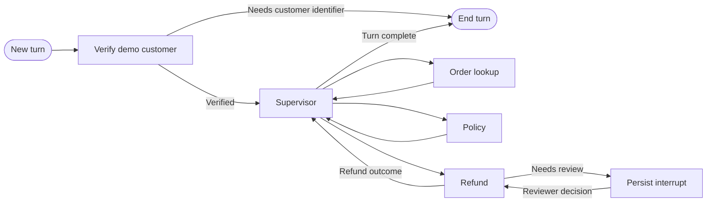

# Architecture

The CLI runs scripted conversations with an in-memory graph checkpointer and temporary SQLite data by default. FastAPI uses a durable checkpointer and exposes state by thread ID. The React console uses those routes to send messages and review refunds.

## Graph guarantees

- Verification sets the customer ID once per thread after a seeded database lookup. All order queries and refund updates use bound parameters scoped to that ID.
- The model can suggest routes, order references and tool calls. Tool execution supplies the state-owned customer ID and checks suggested order references against the customer's orders. An unavailable provider or invalid model output falls back to deterministic logic.
- A turn uses each specialist at most once, with a three-hop backstop. A refund ends delegation for the turn. The graph derives specialist usage from messages added since the last customer message.
- Damage claims and refunds of Rs 5,000 or more pause before the refund write. The refund node replays on resume, so operations before the interrupt are read-only. The scoped update checks refund state in the same statement to prevent duplicate writes.

## API and storage

The API opens the configured LangGraph checkpointer on startup and closes it on shutdown. Each API process serializes graph operations so a second review of an already-resolved interrupt returns HTTP 409. SQLite is the local default. PostgreSQL can back both orders and checkpoints.

The console polls the conversation list, review queue and health endpoint through TanStack Query. It refreshes the relevant lists after a message or review and stores the response under the conversation's own query key.

The model response cache stores LangChain messages, including tool calls. Order and refund lookups execute against the database on every use. The Redis implementation works with a standard Redis server.

## Demo boundary

Customer IDs, emails and phone numbers in the seed data are demo inputs. The HTTP routes are intended for local use with synthetic records. The refund action updates database state and has no payment processor integration.

[Historical design and development notes](archive/)
